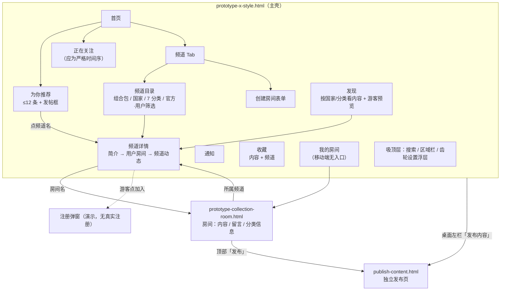

# CN Channels（英国华人社区 H5）熟悉报告

> 审查日期：2026-11-11（伦敦时间）｜范围：`/workspace/uk/src` 副本（只读，未改 Rio 电脑上的任何文件）
> 方法：通读 PRD v1.0 / v1.1（§0–§7、§20、§29–§35 精读，其余扫标题）、MASTER.md、pages/*.md、tokens.css、docs、sdd、memory；在 box 上用 Chrome + Playwright，按 390×844 移动视口点了三个原型的主流程；跑了 6 道门禁脚本。
> 截图：`/workspace/uk/shots/`（复跑脚本：`shots/_run_flow.py`）。各页的可量测数据：`/workspace/uk/audit.json`

---

## 一、一句话概述

一个模仿 X 的中文**频道订阅社区**，英国是第一个开通的法域，首城伦敦。顶层是平台开设的官方频道（签证、租房、交通、留学等），用户在频道下面建「房间」做小圈子（追剧、互助、片单）。首页分三个 Tab：「为你推荐」是可解释的有限推荐，最多 12 条；「正在关注」严格按时间倒序；第三个是「频道」目录。整个产品把合规做成界面元素：来源署名、许可标注、举报、第三方播放器事前同意。

> 注意：v1.0 的定位是「英国本地生活信息站（分类信息为核心）」。v1.1 改成了「全球中文频道社区，英国只是首个法域」。Rio 口头说的是「英国华人本地社区」，两份文档的定位不一致，见五-L1。

---

## 二、产品与信息架构

### 2.1 目标用户（PRD v1.1 §3）
P1 落地新人（0–3 月）· P2 留学生 · P3 常住家庭 · P4 房主 / 频道主 · P5 运营编辑。

### 2.2 对象层级（以 §34 为准）
- **区域 / 法域**：只能由平台开。开通以国家为单位（§33.1）。
- **官方频道**（L1 自动采集 / L2 精选）：目录里只有这一层是顶层。
- **用户房间**：房间名和官方分类必填，所属频道可选（§34.2）。房间只在频道详情里出现，不能再套子房间。
- **内容**：帖子（图文 / 视频 / 话题 / 信息），评论，`@用户` / `#关键词`。

### 2.3 原型里的信息架构

### 2.4 关键主流程（PRD 定义）
1. **首次进入**（§5.4）：游客浏览 → 点「加入」触发轻注册（邮箱 + 手机 + 条款逐项勾选）→ 自动带入频道 → 推荐组合包 → 按浏览器推断简繁 → 进入「正在关注」。
2. **订阅**：点卡片右上角「加入」后，「正在关注」、计数和推荐降权立即同步。
3. **建房**（§34）：从频道详情点「创建房间」→ 自动预选当前频道和分类 → 创建成功回到该频道详情 → 房间里有内容后，其他人才看得到。
4. **发布**：选类型 → 填表 → 进审核。PRD 写的是 202 pending，前台必须显示「审核中」。
5. **通知**：加入房间后自动订阅更新通知（频控摘要），可以按房间静音。

---

## 三、设计系统要点

| 项 | 规则（MASTER v1.7 / tokens.css） |
|---|---|
| 品牌色 | `#1d9bf0` 冻结。拆成 `--accent`（只做装饰）、`--accent-ink`（链接文字）、`--accent-strong` + `--on-accent`（按钮）、`--focus`（焦点环）。浅色主题是深蓝底白字，深色主题是亮蓝底黑字。 |
| 中性色 | `--bg` → `--surface` → `--surface2` 三层；`--border` 做分隔线，`--line`（≥3:1）做控件描边，两者不得混用。 |
| 字体 | 系统字体栈 + Noto TC/SC，不加载外部字体。字阶 11–30px。正文行高 1.6。MASTER §3.2 要求移动端正文 ≥16px。 |
| 间距 / 圆角 | 4px 基准；`--r-sm 6 / md 10 / lg 14 / xl 16 / pill`；z-index 只能用 20/30/50/60 四级。 |
| 触控 | 44px。§17.8 放宽成按命中区算：视觉 30–34px，用 `::after` 扩到 44px。 |
| 与 X 的对应 | 三栏 240/1fr/320；全宽无圆角列表卡，只留底部分隔线；`card-head` 右上角放「加入」+「···」；SourceLine 一行 11px；ActionBar 是 6 个纯 SVG 图标（回复 / 转发 / 喜欢 / 收藏 / 分享 / 举报）；视频没有任何按钮，滑入可视区就静音自动播放，点画面暂停；移动端底部 5 个 Tab。 |
| 与 X 不同的地方 | 推荐流是有限列表，没有无限滚动；每张卡必须有来源、许可、原文链接和举报；第三方视频先静态占位，同意后才加载；推荐理由用 `why-dot` 标出；区域只在顶部出现。 |
| 门禁 | `check-contrast.py` + `check-ui / global / media / location / rooms.js`。**本次 6 道全部 PASS**。但这些门禁只检查 DOM 和字符串，下面列的多数问题都发现不了。 |

---

## 四、当前完成度（390×844 实测）

| 流程 / 页面 | 状态 | 说明 |
|---|---|---|
| 首页三 Tab 切换、深浅色、设置浮层 | ✅ 能跑 | 01/02/03/20 |
| 卡片右上角加入 / 收藏、组合包一键加入 | ✅ 能跑 | 加入状态能同步到计数 |
| 首页发帖框（4 种类型、话题、图片、视频版权勾选） | ⚠️ 半通 | 发出后只出现在「为你推荐」顶部，没有「审核中」状态，进不了房间（11） |
| 频道目录（国家 / 分类 / 类型筛选） | ✅ 能跑 | 04 |
| 频道详情（房间区 + 频道动态） | ✅ 能跑，有 UI 问题 | 返回按钮压住标题（06） |
| 创建房间 | ⚠️ 半通 | 深链失效；选的类型不生效；从部分频道详情进去无法创建（05/22） |
| 房间页（剧集 / 电影 / 视频 / 留言 / 分类信息） | ✅ 单页能跑 | 跨页状态丢失，新建的房间打开后房主变成 @community（21） |
| 发现页 + 游客预览 + 注册弹窗 | ⚠️ 演示级 | 弹窗只有「继续注册（演示）」，没有注册、条款、简繁步骤（10） |
| 通知 / 收藏 | ✅ 能跑 | 08/09 |
| 独立发布页 publish-content.html | ⚠️ 孤岛 | 不能选发到哪个房间或频道，帖子只存在本页 localStorage，主 App 看不到（17/18） |
| 我的房间 | ❌ 移动端进不去 | 只有桌面左栏有入口，移动端底栏没有（19） |
| 注册 / 登录 / 条款同意 / 18+ / 简繁切换 / 我的·隐私·DSAR | ❌ 没做 | PRD §5.4、US-10、US-11 |
| 分类信息详情（价格、区域、有效期、受控查看联系方式） | ❌ 没做 | v1.0 核心，v1.1 §0 保留了「同城分类信息」 |
| 举报流程（选理由 → 工单 → 查看状态） | ❌ 只有 toast | US-09；docs/project-review 也写了不能用 toast 代替工单 |
| 搜索结果页 | ⚠️ 只做了过滤 | 搜索只过滤「为你推荐」，同时会打乱「频道」页的状态（见五-L6） |
| 官方 AI 自动关键词（§30.6） | ❌ 没做 | publish-content.html 里找不到 `autoKeywords`；check-rooms.js 也没测，和 MASTER §12.2 的描述不符 |

---

## 五、逻辑 / 流程问题清单

P0 = 阻断流程跑通；P1 = 明显问题；P2 = 打磨

| # | 级 | 位置 | 现象 | 建议 |
|---|---|---|---|---|
| L1 | P0 | PRD v1.0 §0.2 vs v1.1 §0.1/§26.1 | 定位冲突：v1.0 是「英国本地生活信息站，分类信息为核心」，v1.1 是「全球中文频道社区」。原型 brand 写的是「CN Channels」，Rio 口头说「英国华人本地社区」 | 先定一句话定位。它直接决定首页放频道流还是本地分类信息、分类体系选哪套 |
| L2 | P0 | x-style 全局；PRD §5.4 | 没有注册 / 登录 / 首次引导：缺邮箱手机、条款逐项勾选、18+ 声明、组合包推荐、简繁偏好。游客弹窗点「继续注册（演示）」直接就完成了（`:1948-1955`） | 补一个 3–4 屏的轻注册 H5：账号 → 条款 → 组合包 → 进入「正在关注」，并且带上刚才点过的加入意图 |
| L3 | P0 | x-style `nav.bottom` `:769-775` | 移动端底栏只有 首页 / 频道 / 发现 / 通知 / 收藏。**「发布内容」和「我的房间」在 H5 下没有入口**，左栏在 ≤759px 被隐藏 | 底栏改成 首页 / 频道 / ＋发布（中间）/ 通知 / 我的。「我的」里放我的房间、收藏、设置、简繁、隐私。或者加一个 X 式悬浮发布按钮 |
| L4 | P1 | x-style `renderFollowing()` `:1528-1535` | 「正在关注」写着「严格按时间排序」，实际按数据原顺序：2h、4h、5h、3h、42m、1h；置顶帖排在第 2 位。这是产品的核心语义 | 按 `postAgeMinutes` 升序排，置顶放最前，和 `renderChannelDetail` 的排法统一 |
| L5 | P1 | x-style IIFE `:2230-2257` 后接 `renderAll()` `:2259` | 深链 `?tab=add&seg=create` 落地后，最后那次 `renderAll()` 把分段重置成「频道目录」。房间页的「创建房间」按钮和「频道」导航都依赖这个深链，所以都跳不到创建表单 | 把分段状态存成变量（`addSeg`），由 `renderAdd` 读取；不要在渲染后再改 DOM |
| L6 | P1 | x-style `#searchInput` input 监听 `:2223-2227` | 在「创建房间」分段里填了房间名之后，只要在顶部搜索框打字，分段就跳回目录，房间名也被清空 | 同 L5：分段和表单草稿进状态；搜索只重渲染结果区 |
| L7 | P1 | x-style 创建表单 `:1577-1603`、提交 `:2106-2120`；`check-rooms.js:61`；MASTER §19.2/§20.1；PRD §34.2 | 三份规则互相打架：PRD §34 要求**房间名 + 官方分类必填，所属频道可选**；MASTER §19/§20 写的是只有房间名必填、默认「不挂靠」；原型和门禁写的是**父频道必选、没有分类字段**（分类直接从父频道继承）。另外下拉默认预选「全球华人交流」（`:854`），用户不注意就挂上去了 | 以 §34 为准：加「官方分类（必选）」，频道改成可选、默认为空；同步改 MASTER §19/§20 和 check-rooms 的断言 |
| L8 | P1 | x-style `:2115` | 「更多选项」里选了「剧集 / 电影 / 视频」，提交时 `typeCode` 写死成 `'general'`，选择不生效 | 读 `.rc-type.active` 的值 |
| L9 | P1 | x-style 频道数据 `:794-` + 频道详情「创建房间」 | 英国租房、英国兼职、伦敦二手、伦敦同城活动等是 `kind:'用户共建'`，目录里还有「用户频道」筛选（`:1571`）。这和 §30.1「用户创建的一律叫房间」、§34.1「顶层只有官方频道」冲突。PRD §2.2/§33.3 也明确把英国租房列为全国官方频道。连带问题：英国租房详情页里已经有房间，但点「创建房间」后父频道为空（下拉只列官方频道），这个流程走不通（截图 22） | 两种做法选一个：①把这些频道全部改成官方；②正式定义「用户共建频道」这一层，并写进 §34。我建议①，层级最清楚 |
| L10 | P1 | PRD §33.4（`:3261-3262`）vs §34.1（`:3276`）/§34.3；x-style `:1747-1750` | §33.4 说「房间帖子在关联频道详情中展示」，§34.1 说「房间帖子留在房间内，不自动混入父频道动态」。原型按 §33.4 做了，频道动态里混有「来自房间」的帖子 | 定一条：建议频道动态只放官方内容，房间区只放房间卡 + 最新一条预览 |
| L11 | P1 | collection-room nav map `:1116-1127` | 房间页导航跳错了：「频道」去了创建表单（`seg=create`），「我的房间」去了频道目录（`seg=directory`）。主壳也不认 `page=my-channels` 参数（`:2241`） | 「频道」改成 `tab=add`，「我的房间」改成 `page=my-channels`，主壳加上对这个参数的路由 |
| L12 | P1 | collection-room `:825-836` | 页面之间没有共享状态。主壳新建的房间打开后被当成陌生房间，房主显示 `@community`，你自己的房间也不能当房主管理（截图 21）。房间页的「我的房间」切换器还列出了别人的房间（新闻女王，房主 @manling） | H5 阶段用 `localStorage` 做一个统一的 mock store（subs / rooms / posts / notifications / guest），三个页面共用 |
| L13 | P1 | 发布：首页发帖框 `:1473-1504`、publish-content.html | 两个发布入口规则不一致。首页发帖框可以选「我的动态 / 我的房间」，但不能指定是哪个房间；独立发布页连目标都没有，帖子也回不到主 App。两边发完都提示「已发布」，没有审核中状态（PRD v1.0 §9.3 202、MASTER §7.2 冻结了「审核中，仅自己可见」） | 留一个发布页：先选发布目标（我的房间 X / 某个允许投稿的频道），发完显示「审核中」卡片，并回跳到目标页 |
| L14 | P1 | 分类体系 | 现在有四套分类：官方 7 类（房产 / 招聘 / 市场 / 生活 / 交流 / 活动 / 其他）；发帖「信息」类（生活 / 租房 / 求职 / 求助，`:1379` 和 publish `:391`）；房间分类信息（同城活动 / 二手转让 / 兴趣招募 / 问答互助，room `:569`）；v1.0 的 housing / job / secondhand / service / carshare / event / qa | 统一成一套官方枚举，全部从一个常量生成 |
| L15 | P1 | 举报：x-style `:1802`、卡片 ActionBar；room `:1198/1315` | 点举报直接弹 toast「已提交举报」，没有选理由、没有工单号、看不到处理状态 | 做一个 2 步的举报底部弹层（选理由 → 提交 → 「我的举报」里能看到状态） |
| L16 | P1 | 术语 | 同一个 `subs` 集合，界面上有四种叫法：「加入」（卡片）、「收藏」（目录 / 详情 / 侧栏 `:1548/1766/1645`）、「正在关注」（Tab）、「订阅」（PRD）。游客弹窗标题是「加入频道前」，正文却写「自动收藏」（`:1898`）。memory 11-11 已经把这条列为待决 | 建议：频道用「关注」，房间用「加入」，内容用「收藏」，各管各的 |
| L17 | P1 | 合规一致性：频道详情 posts `:1777-1806` | 频道详情里的帖子没有 SourceLine（来源 / 许可 / 原文），sdd official-channel-post-feed 写的是「有意省略」。这违反 MASTER §7.1/§17.9「每张卡必显」 | 改为复用 `cardHTML` 或 SourceLine 组件 |
| L18 | P1 | PRD §35 / MASTER §20.6 vs 原型 `:1624`、memory 11-11 | §35 要求「添加页里的创建分段」显示成「频道」，原型显示「创建房间」，11-11 的日志是有意改回去的。这样文档和实现又不一致了 | 建议正式采用「创建房间」（避免一个页面里出现两个「频道」），然后回写 §35 / MASTER |
| L19 | P2 | home-feed.md「AutoCityTopic」vs PRD §33.2、docs/project-review | 规范写的是「城市话题需用户主动添加」，PRD 写的是「确认定位后自动预填，可移除」。原型按规范做（`:1994`） | 二选一回写。建议用户主动添加，隐私更稳 |
| L20 | P2 | 「正在关注」空态 `:1534` | 文案「去「添加频道」挑几个吧」用的是旧称，而且没有按钮 | 改成「去频道目录看看」加主按钮（MASTER §8 已经有这条文案） |
| L21 | P2 | 加入房间后的去向 | §32.4 说加入的房间进「正在关注」，§34 没有明确说。原型里房间更新只走通知 | 明确房间更新只进通知，还是也进「正在关注」 |
| L22 | P2 | 文档卫生 | v1.1 头部声明了 12 个优先级章节；`### 32.11` 排在 §33 后面（`:3265`）；MASTER 没跟上 §33/§34（§20.2 还写着房间可以进目录）；pages-collection-discovery-notification.md 用的是旧紫色体系 | 把 §20–§35 合并成一份「现行规则」单章，旧章节移到附录；旧页面文档挪到 archive |

---

## 六、UI 问题清单

| # | 级 | 位置 | 现象 | 建议 |
|---|---|---|---|---|
| U1 | P1 | x-style `<svg class="sprite">` `:671`，CSS 里缺 `.sprite` 规则 | **页面顶部有 156px 空白**，移动端和桌面都有（截图 01/00）。原因是 SVG sprite 没被隐藏，按默认 300×150 渲染出来了。memory 11-11 判断为「预览容器留白」，这个判断是错的。房间原型 `:38` 有这条规则，所以房间页没问题 | 补一行 `.sprite{position:absolute;width:0;height:0;overflow:hidden}` |
| U2 | P1 | 频道详情 `.channel-detail-back` `:222/605` | 绝对定位的「← 返回频道目录」压住了频道名「英国租房」（截图 06） | 改成吸顶栏左侧的 44px 返回图标（X 式），不要压在封面上 |
| U3 | P1 | 卡片 `:1338` | 不是用户帖的卡片都会显示 `✓ verified`，包括「用户共建」的伦敦同城活动。违反 §18.1「用户内容不得用认证徽章」；✓ 还是 Unicode 字符，违反 §3.6 | 只给 `kind` 以「官方」开头的频道显示，并改用 `#i-check` SVG |
| U4 | P1 | 房间页吸顶区 `:403-428` | 390px 下「我的房间」6 个 chip、房间类型切换和子 Tab 加起来约 450px，正文要到半屏以下才出现（截图 13）。房间类型切换写着「此处可切换预览」，是给原型演示用的控件，却对所有访客可见 | 房间切换器收进标题下拉；类型切换只对房主显示，或移进房间设置；吸顶区只留标题和子 Tab |
| U5 | P1 | 字号：MASTER §3.2 vs §17.3 | 规范自己就冲突：§3.2 要求移动端正文 ≥16px，§17.3 规定卡片正文 14px。实测 body 15px、卡片正文 14px。x-style 里 10–11px 的声明有 54 处：card-join 11、SourceLine 11、lic 10、owner-tag 10、cstat 11、搜索按钮 11 | 中文用户里中老年人不少，建议移动端正文 15–16px、元信息 ≥12px、徽章 ≥11px，再回写 MASTER |
| U6 | P1 | 触控区（390 实测，已计入 `::after`） | 搜索输入框高 35px；`.ts-btn` 34px；`.page-filter` 36px；`.mini-btn` 27px（如「加入房间」「去发现」）；`.add-seg` 40px；publish 页 `.publish-btn` 36px；频道名文字按钮 17–22px | 统一 `min-height:var(--tap)`，或补 `::after` 扩展命中区 |
| U7 | P2 | z-index：x-style `:256`（90）、`:308`（99）、`:514`（25）；room `:249`（90） | 超出 20/30/50/60 的层级规定 | 换成 `--z-*` token |
| U8 | P2 | 硬编码颜色和尺寸 | x-style 的 CSS 里有 12 处 hex（`#fff`×8、`#9aa6b1`、`#0b0f12`），内联 `#7856ff` 头像（`:715/1385`），房间页内联 `font-size:14px`（`:405`）。三个原型都没有引入 tokens.css，只是复制了颜色变量，`--fs-* / --sp-*` 全部没用上 | 原型直接 `<link>` tokens.css，字号和间距改用变量 |
| U9 | P2 | Unicode 图标 | `✓`（卡片、详情）、`←`（`:1756`）、`✦`（`:1518`） | 换成 SVG symbol |
| U10 | P2 | 首页 Tab `:738-742` | `role="tab"` 没有 `aria-selected` | 在 `switchTab` 里同步设置 |
| U11 | P2 | 未读角标 `:707/1843` | 「首页」和「通知」两处都显示 3 | 角标只放在「通知」上 |
| U12 | P2 | 移动底栏 | 纯图标，「频道」用的是 ＋ 号，用户会以为是「发布」 | 加文字标签（华人用户习惯，参考微信 / 小红书），频道改用网格或指南针图标 |
| U13 | P2 | 设置浮层（截图 02） | 面向用户的文案里有大量法务和技术术语：DSA Art 27、PECR、CDN 边缘 IP、0.40/0.30 权重，还有「演示」分组 | 用户端换成白话，例如「为什么推荐给我」「第三方视频怎么加载」；参数表折叠到「了解更多」 |
| U14 | P2 | UGC 卡的 SourceLine | 用户帖也显示「来源 · UGC · 查看原文」，原文就是它自己 | UGC 只显示「用户发布 · UGC」，不放原文链接 |
| U15 | P2 | 简繁混排 | 简体界面里，系统生成的文案混着繁体：why-dot「同區域頻道近 7 日新增 5 條」、房间页 toast「已卸載第三方播放器」。违反 §7.6 | 系统文案按界面语言出；用户原文保持不改 |
| U16 | P2 | 本地生活信息密度 | 卡片是 X 式的纯话题流。租房 / 二手 / 招聘这类需要价格 £、区域、有效期、联系方式入口，首页卡片里都没有结构化字段 | 给「信息」类帖子单独一种卡片：价格、区域 / 邮编段、剩余天数、「查看联系方式（需登录）」 |

---

## 七、建议的下一步（H5 流程跑通前优先做）

1. **先拍板三件事**，30 分钟内能定：① 一句话定位（v1.0 本地信息站，还是 v1.1 频道社区）；② 房间创建规则按 §34 统一（分类必填、频道可选、房间帖子进不进频道动态）；③ 术语（关注频道 / 加入房间 / 收藏内容）。定完一次性回写 PRD、MASTER 和 check-rooms。
2. **修 5 个硬 bug**，都是小改动：U1 sprite 空白、L4「正在关注」排序、L5/L6 创建分段状态、L8 房间类型不生效、L11 房间页导航跳错。
3. **补 H5 骨架**：移动端底栏加「发布」和「我的」（L3）；做一个轻注册 3 屏（L2）；「我的」页面放我的房间、收藏、简繁、隐私与数据。
4. **建一个共享的 mock store**（localStorage）：三个页面共用订阅、房间、帖子、通知和游客状态，让「建房 → 发帖 → 审核中 → 别人在频道详情看到 → 加入 → 收到通知」能完整走一遍（L12/L13）。
5. **补关键状态和门禁**：审核中卡片、举报底部弹层、加载 / 错误态；门禁里加真实浏览器的流程断言（排序、深链、移动端入口可达），并以 390px 截图作为验收标准。现有门禁全绿，但上面这些问题它都没发现。

---

### 附：截图清单（/workspace/uk/shots/）
00-desktop-home · 01-home-foryou（+01b 全页）· 02-settings-panel · 03-following · 04-channel-directory · 05-create-room · 06-channel-detail（+06b）· 07-discover · 08-notifications · 09-favorites · 10-guest-join-modal · 11-home-composer-open · 13-room-series · 14-room-comments · 15-room-video · 16-room-nav-myrooms-landing · 17-publish · 18-publish-info · 19-my-rooms-desktop-only-entry · 20-home-light · 21-new-room-opened · 22-create-room-from-housing

### 附：门禁结果
`check-contrast.py`、`check-ui.js`、`check-global.js`、`check-media.js`、`check-location.js`、`check-rooms.js` 全部 PASS。运行过程中没有 console 报错。
